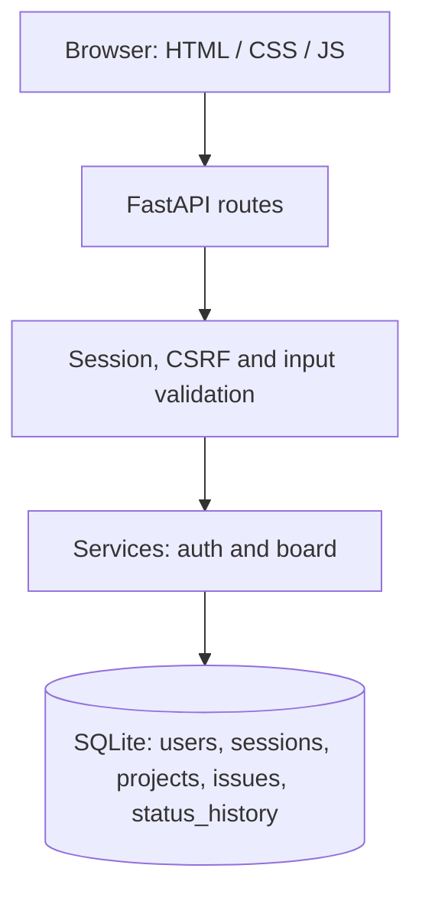
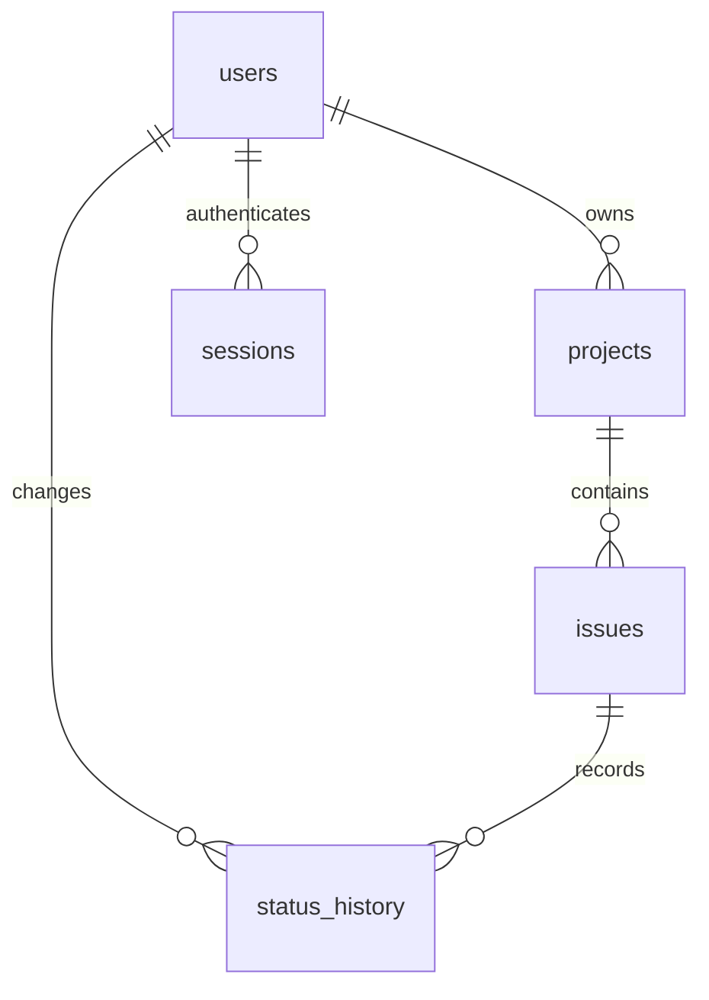

# Architecture and design decisions

IssueBoard is deliberately small: one FastAPI process, a SQLite database and a browser interface served from the same origin. There is no separate front-end build or message broker.

## Request flow

- `app/main.py` creates the application, serves the UI and adds response headers.
- `app/routers/` translates HTTP requests into service calls.
- `app/schemas.py` validates incoming data and shapes API responses.
- `app/dependencies.py` supplies a per-request database connection and checks session/CSRF.
- `app/services/` enforces ownership, task transitions and authentication rules.
- `app/database.py` manages SQLite connections and the initial schema.
- `app/static/` contains the browser-facing interface.

## Main data relationships

Every project belongs to one user. The service verifies the project owner before reading or writing issues and status history. A missing issue and an issue belonging to someone else both return 404, avoiding unnecessary information disclosure.

## Why SQLite and handwritten SQL?

This is a local portfolio project, with deliberately limited collaboration requirements. Direct SQL keeps queries and transaction boundaries visible, and avoids an ORM dependency. Every request has its own connection and foreign-key enforcement is enabled. Query values use placeholders, while sort direction comes from an explicit allowlist.

Trade-off: this approach keeps a small project understandable but does not provide a migration system, distributed scaling or powerful server-side search out of the box.

## Status changes are atomic

When an issue status changes, the service:

1. Begins an SQLite `BEGIN IMMEDIATE` transaction.
2. Reads the previous issue state.
3. Updates the issue fields and timestamp.
4. Inserts a status-history record only if the status changed.
5. Commits both changes together.

If insertion into the history table fails, the issue update is rolled back. There is an integration test that injects a genuine SQLite trigger failure to check this behavior.

## Session security

- Passwords are hashed with Argon2id, never stored as plaintext.
- The browser holds a random session token in an HttpOnly SameSite=Strict cookie.
- SQLite stores a SHA-256 hash of that token, not its raw value.
- Authenticated state-changing requests require a CSRF token supplied separately.
- User-provided text is added to the DOM through `textContent`.
- Requests and responses are same-origin; CORS is not enabled.

This reduces common risks for the local prototype. It is **not** a complete production security guarantee: reverse-proxy trust, HTTPS, password recovery, operational logging, backup and abuse controls require further work.

## Deliberate limitations

- The application has a single owner per project, no team invitations or permissions hierarchy.
- Project names and issue fields are editable; projects themselves do not currently have edit/delete endpoints.
- The current schema is initialized with `CREATE TABLE IF NOT EXISTS`, not versioned migrations.
- A concurrent stale edit may overwrite a newer edit (last-write-wins).
- Title filtering uses Python `casefold`, meaning it scans selected rows rather than using indexed full-text search.
- The interface has not undergone a verified cross-browser/manual mobile review.

These limitations are part of the scope of the learning project, not hidden future features.
